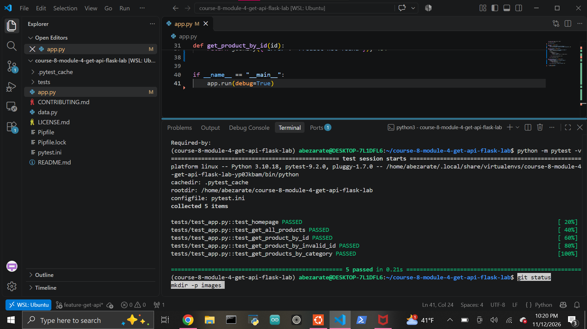

# Building RESTful GET APIs with Flask

A small read-only RESTful API built with Python and Flask.

The application demonstrates:

- HTTP GET routes
- JSON responses
- collection endpoints
- individual resource endpoints
- query-string filtering
- dynamic URL parameters
- case-insensitive filtering
- 404 error handling

## Features

The API exposes four main behaviors:

### Homepage

```text
GET /
```

Returns a JSON welcome message.

Example:

```json
{
  "message": "Welcome to the product catalog API"
}
```

### Get All Products

```text
GET /products
```

Returns the full product catalog as JSON.

Example response:

```json
[
  {
    "id": 1,
    "name": "Laptop",
    "price": 899.99,
    "category": "electronics"
  },
  {
    "id": 2,
    "name": "Book",
    "price": 14.99,
    "category": "books"
  },
  {
    "id": 3,
    "name": "Desk",
    "price": 199.99,
    "category": "furniture"
  }
]
```

### Get One Product

```text
GET /products/<id>
```

Returns the product matching the requested ID.

Example:

```text
GET /products/2
```

Response:

```json
{
  "id": 2,
  "name": "Book",
  "price": 14.99,
  "category": "books"
}
```

If the product does not exist, the API returns:

```text
404 Not Found
```

with a JSON error message:

```json
{
  "error": "Product not found"
}
```

### Filter Products by Category

```text
GET /products?category=books
```

Returns only products in the requested category.

Filtering is case-insensitive, so values such as:

```text
books
Books
BOOKS
```

are treated the same.

## Product Data

The mock product catalog contains:

```python
products = [
    {
        "id": 1,
        "name": "Laptop",
        "price": 899.99,
        "category": "electronics",
    },
    {
        "id": 2,
        "name": "Book",
        "price": 14.99,
        "category": "books",
    },
    {
        "id": 3,
        "name": "Desk",
        "price": 199.99,
        "category": "furniture",
    },
]
```

## Project Structure

```text
course-8-module-4-get-api-flask-lab/
├── images/
│   └── tests-passing.png
├── tests/
│   ├── __init__.py
│   └── test_app.py
├── app.py
├── data.py
├── Pipfile
├── Pipfile.lock
├── pytest.ini
└── README.md
```

## Setup

Install dependencies:

```bash
pipenv install
```

Enter the virtual environment:

```bash
pipenv shell
```

This project uses Python 3.10.

## Running the API

Start the Flask development server:

```bash
python app.py
```

By default, Flask runs at:

```text
http://127.0.0.1:5000
```

## Example Requests

Homepage:

```text
http://127.0.0.1:5000/
```

All products:

```text
http://127.0.0.1:5000/products
```

One product:

```text
http://127.0.0.1:5000/products/2
```

Filtered products:

```text
http://127.0.0.1:5000/products?category=books
```

## REST Design

The application follows several REST conventions:

- collection routes use plural nouns such as `/products`
- GET requests retrieve data without modifying it
- JSON is returned using `jsonify()`
- dynamic route parameters identify individual resources
- query parameters filter collections
- successful requests return `200 OK`
- missing resources return `404 Not Found`

## Query Filtering

The category filter is read using:

```python
request.args.get("category")
```

Both the user input and stored category are normalized with `.lower()` before comparison.

This prevents case differences from producing incorrect results.

## Error Handling

If a requested product ID does not exist, the API returns:

```text
404 Not Found
```

with:

```json
{
  "error": "Product not found"
}
```

This gives API clients a clear machine-readable error response instead of failing silently.

## Testing

Run the automated test suite with:

```bash
python -m pytest -v
```

Current result:

```text
5 passed
```

The tests verify:

- the homepage returns a `200` response with a welcome message
- `/products` returns a product list
- `/products/2` returns the correct product
- `/products/99` returns `404`
- `/products?category=books` returns filtered results

## Completed Test Suite



## Technologies

- Python
- Flask
- pytest
- Pipenv
- Git
- GitHub

## Author

Abraham Zarate